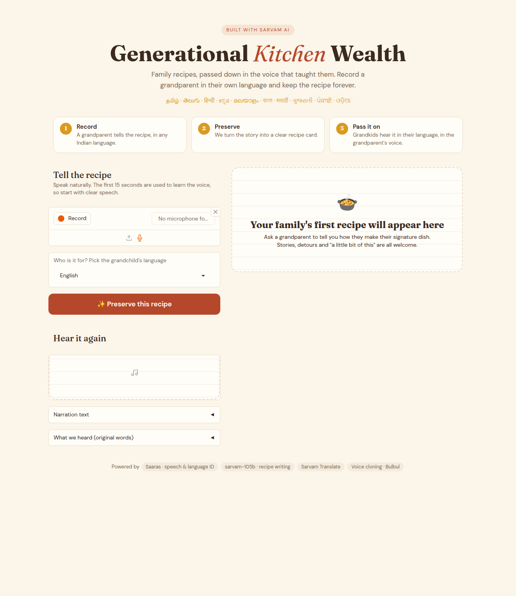
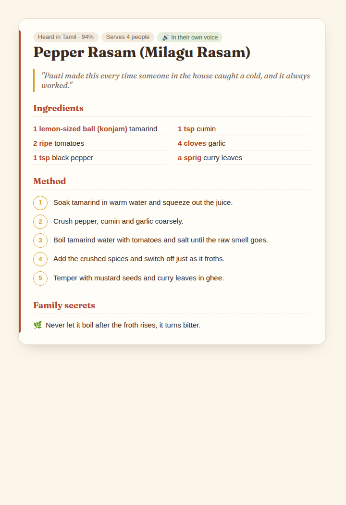

# Generational Kitchen Wealth

Family recipes, passed down in the voice that taught them.

A grandparent speaks a recipe in an Indian language. The application writes a clear recipe card. It translates the recipe into the language of the grandchild. Then it speaks the recipe in the voice of the grandparent.

This project uses the Sarvam AI APIs. We made it for the Sarvam Buildathon.



## The problem

Many family recipes are not written. They are only in the memory of the elders. The elders speak them in their own language or dialect. They use quantities such as "a little" or "a fistful". The grandchildren often cannot read or understand that language. When the elders are gone, the recipes are lost.

## What the application does

1. It records the grandparent. The grandparent can use any of 11 Indian languages.
2. It finds the language of the speech automatically.
3. It writes the speech as text.
4. It makes a recipe card from the text. The card has the ingredients, the steps, the tips and the family story.
5. It translates the recipe into the language of the grandchild.
6. It speaks the recipe in a copy of the voice of the grandparent.



## How it works

```
Audio --> Saaras (speech to text, language ID)
      --> sarvam-105b (recipe card as JSON)
      --> Sarvam Translate (grandchild's language)
      --> Voice cloning (grandparent's voice)
          or Bulbul TTS (if voice cloning is not available)
      --> Audio
```

| Step | Sarvam API | Function in `pipeline.py` |
|---|---|---|
| Speech to text and language identification | Saaras (`saaras:v3`) | `transcribe` |
| Recipe card | `sarvam-105b` | `structure` |
| Translation | Sarvam Translate (`sarvam-translate:v1`) | `translate` |
| Speech in the voice of the grandparent | Voice cloning | `speak` |
| Speech with a standard voice (fallback) | Bulbul (`bulbul:v3`) | `speak` |

### Design decisions

- **Language identification at no extra cost.** Saaras gives the language with the transcript. The application does not make a separate API call for the language.
- **Audio chunks.** The Saaras REST API accepts clips shorter than 30 seconds. The application cuts the recording into chunks. The first chunk is 15 seconds. The other chunks are 25 seconds.
- **Voice reference.** The application uses the first chunk as the voice reference for voice cloning. Thus, the first 15 seconds must have clear speech.
- **Fallback.** Voice cloning is a beta API. If voice cloning fails, the application uses a standard Bulbul voice.
- **Cache.** The application keeps each result in the `cache/` folder. If you use the same recording again, the application does not use API credits.

## Requirements

- Python 3.10 or higher
- ffmpeg
- A Sarvam AI API key. Get the key from the [Sarvam AI dashboard](https://dashboard.sarvam.ai).

## Installation

1. Clone the repository:
   ```
   git clone https://github.com/Lonewalker0912/Sarvam-Buildathon.git
   cd Sarvam-Buildathon
   ```
2. Install ffmpeg. On Ubuntu, use this command:
   ```
   sudo apt install -y ffmpeg
   ```
3. Make a virtual environment:
   ```
   python3 -m venv .venv
   ```
4. Install the Python packages:
   ```
   .venv/bin/pip install -r requirements.txt
   ```
5. Make a file with the name `.env` in the project folder.
6. Write your API key in the `.env` file:
   ```
   SARVAM_API_KEY=your_key_here
   ```

> **CAUTION:** Do not commit the `.env` file. The `.gitignore` file prevents this. Do not write the API key in the code.

## Test the API key

1. Run the test script:
   ```
   .venv/bin/python hello_sarvam.py
   ```
2. Make sure that the script shows a reply from the model.

If the script shows an error, examine the API key in the `.env` file.

## Start the application

1. Run the application:
   ```
   .venv/bin/python app.py
   ```
2. Open http://127.0.0.1:7860 in a web browser.
3. Click **Record**. Allow the browser to use the microphone.
4. Speak the recipe. Alternatively, upload an audio file.
5. Select the language of the grandchild.
6. Click **Preserve this recipe**.
7. Wait for the recipe card and the audio.

To stop the application, push **Ctrl+C** in the terminal.

## Use the command line

You can also process a 16-bit WAV file without the web page:

```
.venv/bin/python pipeline.py recording.wav Hindi
```

The second argument is the language of the grandchild. If you do not give this argument, the application uses English.

## Recommendations for good results

- Record in a quiet room.
- Start with 15 seconds of clear speech. The application uses this part to copy the voice.
- Keep the recording between 30 and 90 seconds. Longer recordings use more API credits.
- Let the grandparent speak naturally. Stories and approximate quantities are acceptable.

## Project files

| File | Content |
|---|---|
| `app.py` | The web page (Gradio) |
| `pipeline.py` | The Sarvam API calls and the audio processing |
| `hello_sarvam.py` | A short script to test the API key |
| `requirements.txt` | The Python packages |
| `docs/` | The screenshots |
